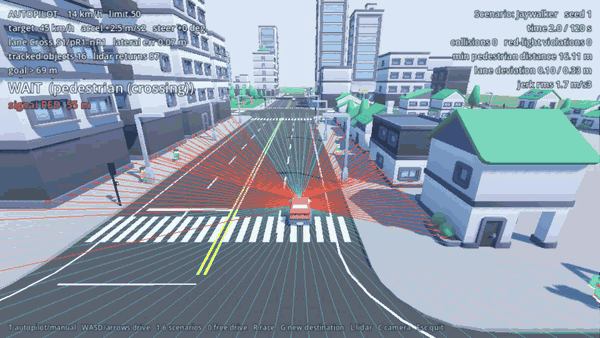
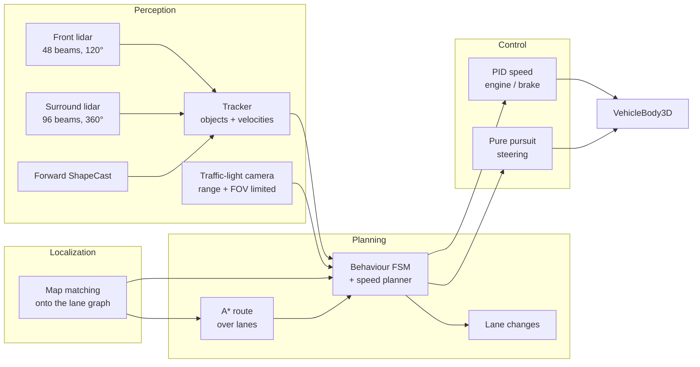

# autonomy-gp

A small self-driving car in a living city, built in Godot 4.7 (Forward+, Jolt physics).
The ego car senses the world with a lidar, matches itself to the lane map, plans an
A* route, decides what to do with a behaviour state machine and drives a real
`VehicleBody3D` with pure-pursuit steering and a PID speed controller. Around it run
50 NPC cars, 40 pedestrians (some of whom jaywalk), signalised junctions with
pedestrian scrambles, a roundabout, road works and a highway loop.



## Pipeline



```
 lidar x2 + shapecast ─► tracker ─┐
 traffic-light camera ────────────┼─► behaviour FSM + speed planner ─► pure pursuit ─► steering
 pose ─► map matching ─► A* route ┘        │                         └► PID ─► engine force / brake
                                           └─► lane changes (re-plan A*)
```

| Stage | What it does | Code |
|---|---|---|
| Lidar | RayCast3D fans on layers 2-5 (vehicles, pedestrians, obstacles, buildings). The surround unit interleaves its beams every other frame like a spinning lidar. `L` shows the beams. | `autonomy/sensors/lidar.gd` |
| Tracker | Groups returns into objects, estimates each object's velocity from frame to frame, coasts briefly through missed frames. | `autonomy/sensors/perception.gd` |
| Forward ShapeCast | A box swept 25 m ahead of the bumper: a short-range safety net. | `autonomy/ego/ego_car.tscn` |
| Traffic-light camera | Reads the signal for the lane ahead, only within 90 m, inside a 180° field of view and not behind a building; drops 3% of frames, so the planner has to handle "unseen". | `autonomy/sensors/traffic_light_camera.gd` |
| Localization | Projects the car onto its route lanes (no confusion where junction lanes overlap); falls back to a global `TrafficNetwork.nearest()`-style search and re-plans if the car is more than 4 m off its lane. | `autonomy/localization/localizer.gd` |
| Routing | A* over the lane graph (successors + lane changes), straight-line heuristic, skipping the unprotected left turns NPCs also avoid. | `autonomy/planning/route_planner.gd` |
| Reference path | The route ahead sampled every meter, with curvature speed limits and events: stop lines, roundabout yields, merges, goal. | `autonomy/planning/ref_path.gd` |
| Behaviour | Gathers stop constraints (speed limits, curves, lights, yields, merges, objects in or entering the corridor) and picks the tightest. States: `CRUISE`, `FOLLOW`, `STOP_AT_LIGHT`, `YIELD`, `EMERGENCY_BRAKE`, `LANE_CHANGE`, `WAIT`, `ARRIVED`. | `autonomy/planning/behaviour.gd` |
| Control | Pure pursuit (`δ = atan(2L sin α / Ld)`, look-ahead grows with speed) and a PID on speed with a jerk limit; the car maps acceleration to engine force or brake from its measured response. | `autonomy/control/`, `autonomy/autopilot.gd`, `autonomy/ego/ego_car.gd` |
| Scoring | Ground truth from the simulator: collisions, red-light violations, closest pedestrian, lane deviation, time, jerk. | `autonomy/scenarios/metrics.gd` |

### What is ground truth and what is sensed

This is a learning project, so some shortcuts are deliberate and labelled:

- **Object classes come from collision layers.** The lidar knows whether a return hit a
  vehicle, a pedestrian, an obstacle or a building, the way a segmentation network would
  tell you. Returns are grouped into objects by the body they hit (a stand-in for
  clustering). Positions and velocities, though, are only what the beams see.
- **The traffic-light camera is ground-truth assisted.** It does not run a detector on
  pixels; it reads the colour of signal heads it could plausibly see (range, field of
  view, building occlusion, random dropout). Unseen lights are treated as red if the car
  can still stop comfortably.
- **Pose is exact odometry** from the physics body; localization is the map matching on top.

## Controls

| Key | Action |
|---|---|
| `T` | Autopilot on / off (manual driving) |
| `W A S D` / arrows, `Space` | Drive manually, handbrake |
| `1` - `6` | Run a scenario (red light, jaywalker, road works, roundabout, highway merge, cross-town) |
| `0` | Free drive: the autopilot keeps picking random destinations |
| `R` | Race mode: time trial on the highway loop |
| `G` | New random destination |
| `L` | Show the lidar beams |
| `C` | Camera: chase, high chase, top-down |
| `Esc` | Quit |

Open the project in Godot 4.7 and press Play: the main scene is `autonomy/sim.tscn`, which
loads the city from `node_3d.tscn` and starts in free drive.

## Scenarios

Every scenario runs in the full city: NPC traffic, pedestrians and signals on their usual
cycles. A run passes when the car reaches its goal in time with **0 collisions, 0
red-light violations, at least 1.0 m from every pedestrian and within 1.5 m of its
reference path**.

| Scenario | What it tests |
|---|---|
| `red_light` | The light ahead turns yellow then red as the car approaches: stop at the line, wait out the cycle (including the pedestrian scramble), go on green. |
| `jaywalker` | A pedestrian steps off the kerb 28 m ahead, mid-block: predict the crossing, brake, wait, carry on. |
| `road_works` | Cones and barriers close the right lane: change lanes around them, then turn left at a T-junction. |
| `roundabout` | Enter from the west, yielding to circulating traffic (extra cars are spawned to make sure there is some), exit north. |
| `highway_merge` | On-ramp merge into fast traffic (six extra cars timed to arrive with the ego car): gap acceptance over the whole taper, then cruise at 100 km/h. |
| `cross_town` | A* route across the city through several signals and turns. |

### Running them headless

```sh
godot --headless --path . -- --scenarios all                 # all six, seeds 1,2,3
godot --headless --path . -- --scenarios red_light,jaywalker --seeds 4,5
godot --headless --path . -- --race --laps 1                 # time trial
```

The runner re-launches itself with `--fixed-fps 60`, so physics still steps at exactly
60 Hz but the run goes as fast as the CPU allows (a few minutes for all six scenarios over three seeds). It writes
`results/scenario_results.json` and `results/scenario_results.csv` and exits with code 1
if any run fails. `--trace` prints the car's state every second.

### Results

| Scenario | Passed | Collisions | Red-light violations | Min. pedestrian distance | Max lane deviation | Mean time | Jerk (RMS) |
|---|---|---|---|---|---|---|---|
| `red_light` | 5/5 | 0 | 0 | 12.75 m | 0.34 m | 55.7 s | 1.7 m/s³ |
| `jaywalker` | 5/5 | 0 | 0 | 3.01 m | 0.34 m | 38.2 s | 2.2 m/s³ |
| `road_works` | 5/5 | 0 | 0 | 2.18 m | 0.47 m | 55.6 s | 2.8 m/s³ |
| `roundabout` | 5/5 | 0 | 0 | 8.71 m | 1.06 m | 37.8 s | 2.1 m/s³ |
| `highway_merge` | 5/5 | 0 | 0 | no pedestrians near | 0.37 m | 50.1 s | 2.0 m/s³ |
| `cross_town` | 5/5 | 0 | 0 | 12.61 m | 0.34 m | 156.8 s | 1.7 m/s³ |

30/30 runs passed over seeds 1, 2, 3, 4, 5 (`godot --headless --path . -- --scenarios all --seeds 1,2,3,4,5`). Per-run numbers, including collision logs and time spent in each behaviour state, are in [`results/scenario_results.json`](results/scenario_results.json) and [`results/scenario_results.csv`](results/scenario_results.csv).

## Race mode ("GP")

`R` (or `--race`) puts the car on the highway on-ramp for a flying-lap time trial round
`HW_Loop` in live traffic. The autopilot is allowed 120% of the posted limit and
overtakes slower cars; the HUD shows the current, best and previous laps.

Headless result (`godot --headless --path . -- --race --laps 2`): laps 114.57 s, 104.70 s, best lap **104.70 s**, average 81.6 km/h, 0 collisions. Saved in [`results/race_result.json`](results/race_result.json).

## Project layout

```
autonomy/            the self-driving stack (this project's AV code)
  sensors/           lidar, tracker, traffic-light camera
  localization/      map matching
  planning/          A* routing, reference path, behaviour FSM
  control/           pure pursuit, PID
  ego/               the ego VehicleBody3D scene
  scenarios/         scenario definitions, director, metrics
  race/              time-trial mode
  ui/                HUD and chase camera
  sim.tscn           main scene (city + ego car)
  session.gd         autoload: what to run, batch runner
node_3d.tscn         the city: roads, junctions, signals, props
traffic/             lane graph and signal controllers
npc_car.gd           NPC traffic, traffic_seeder.gd spawns it
pedestrians/         sidewalks, crosswalks, jaywalkers
props/ city/         parked cars, cones, signs, buildings
results/             committed scenario results
```

## Known limitations

- NPC cars are kinematic and only look about 34 m ahead along their own lane, so they
  can't avoid a much slower car that appears in their lane at highway speed. The ego
  car's merge logic therefore waits for generous gaps, and it never stops inside a
  tapered merge.
- Lane changes happen around static obstacles, when the route needs a different lane,
  and (race mode) to overtake; there is no general "change to a faster lane" logic.
- The ego car avoids unprotected left turns at shared-phase signals, like the NPCs.
- Results are deterministic for a given seed on one machine; Jolt is not guaranteed to
  be bit-identical across platforms.
